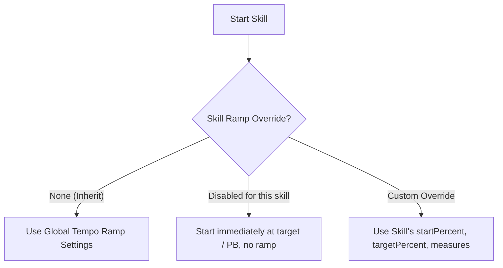

# Feature Evaluation & Implementation Plan: Skill-Level Tempo Ramp Overrides

## Goal Description
Evaluate whether individual skills in Tempo Daddy should support per-skill Tempo Ramp overrides (or opt-out), assess UX complexity vs. user value, and present an actionable implementation plan if approved.

Currently, **Tempo Ramp** is a global setting:
- Configured via `TempoRampModal` (`startPercent`, `targetPercent`, `measures`, `enabled`).
- Stored globally in localStorage via `storageManager` and synced to cloud (`cloudSync.ts`).
- When a skill starts (`loadSkill` in `App.tsx`), it calculates `warmup` and `rampTarget` from the global ramp percentages and skill's `personalBestBpm`.

The question is: **Is giving individual skills the capability to override the global tempo ramp with a unique setting a good design choice?**

---

## 1. Product & UX Evaluation: Is It a Good Design Choice?

### The Good: Legitimate Practice Use Cases
1. **Technique vs. Endurance vs. Speed Drills**:
   - *Finger independence / complex polyrhythm drill*: Needs starting much slower (e.g., 60% PB to 80% PB) over a longer runway (32 measures) because tension creeps in quickly.
   - *Familiar single stroke warmup*: Can jump right into 85% $\to$ 95% over 8–16 measures.
   - *Burst / Speed limit drill*: May want to ramp from 90% $\to$ 102% PB over just 4 or 8 measures.
2. **Explicit Opt-Out / Non-Ramping Skills**:
   - Fixed-tempo or grooving exercises (e.g., timekeeping practice, syncopation drills, or fixed-speed micro-timing work) where starting at 80% PB and accelerating feels awkward or counterproductive.

### The Bad: Risks of User Confusion & Interface Bloat
1. **Mental Model Confusion (The "Why did this skill start at 60%?" problem)**:
   - If ramp settings are hidden inside individual skill editors, users often forget they customized a skill weeks ago and wonder why the global ramp toggle or percentages aren't behaving consistently.
2. **Setup Friction (Premature Optimization)**:
   - 90% of musicians want frictionless practice: select a skill, hit Space, and play. Forcing or prominently displaying ramp controls on every skill creation/edit form adds cognitive noise to an already busy modal (`SkillLibraryModal`).
3. **Redundant Repetition**:
   - If a user wants to tweak their warmup routine from 80% to 75%, having overrides on 12 different skills means they have to hunt down and update 12 modals individually or suffer inconsistency.

---

## 2. Verdict & Design Recommendation

> [!TIP]
> **Recommendation: "Opt-in Override Pattern" (Progressive Disclosure)**
> Do **NOT** expose a full set of ramp inputs by default in the skill modal.
> Instead, keep Global as the single source of truth, and offer a clean, secondary accordion/toggle in the Skill Edit dialog:
> - **Tempo Ramp**: `Use Global Setting` (default) vs `Custom Ramp for this skill` / `Disable Ramp for this skill`.

### Proposed Mode Hierarchy


### Why this works best:
1. **Zero clutter for normal users**: 95% of users will never touch it and see no extra required fields.
2. **Clarity on Practice Screen**: When a skill with a custom ramp or disabled ramp is playing, show a small pill indicator (e.g. `Custom Ramp 70%->95%` or `Global Ramp`) next to the ramp banner, so the user always knows *why* the metronome is doing what it's doing.
3. **Simplicity of implementation**: Fully backward compatible with existing user databases and cloud sync.

---

## 3. Technical Architecture & Data Model

### Data Structure Changes

#### In `src/types/index.ts`
```typescript
export interface SkillTempoRampOverride {
  enabled: boolean;          // false = disabled for this skill specifically
  useCustom: boolean;        // true = use custom params below; false = inherit global
  startPercent?: number;     // e.g. 70
  targetPercent?: number;    // e.g. 95
  measures?: number;         // e.g. 24
}

export interface Skill {
  id: string;
  title: string;
  // ... existing fields
  tempoRamp?: SkillTempoRampOverride; // Optional, backward compatible
}
```

#### In `src/App.tsx` (`loadSkill` logic)
```typescript
const effectiveRamp = useMemo(() => {
  // If skill specifies an override:
  if (skill.tempoRamp?.useCustom) {
    return {
      enabled: skill.tempoRamp.enabled,
      startPercent: skill.tempoRamp.startPercent ?? tempoRampSettings.startPercent,
      targetPercent: skill.tempoRamp.targetPercent ?? tempoRampSettings.targetPercent,
      measures: skill.tempoRamp.measures ?? tempoRampSettings.measures,
    };
  }
  if (skill.tempoRamp && !skill.tempoRamp.enabled) {
    // Explicitly disabled for this skill
    return { ...tempoRampSettings, enabled: false };
  }
  // Fall back to global
  return tempoRampSettings;
}, [skill, tempoRampSettings]);
```

#### UI in `SkillLibraryModal.tsx`
Under an expandable or segmented control inside the Skill Edit view:
- **Tempo Ramp**:
  - `[ Inherit Global ]` (default)
  - `[ Custom ]` $\to$ reveals compact inputs for Start % PB, Target % PB, and Measures (prefilled with global values)
  - `[ Off for this exercise ]`

---

## 4. User Review Required

> [!IMPORTANT]
> **Key Decisions to Confirm**:
> 1. **Do you want to proceed with implementing this feature?**
>    - Or do you prefer keeping Tempo Ramp strictly global to preserve simplicity?
> 2. **If proceeding, does the 3-option model fit your vision?**
>    - `Inherit Global` (default)
>    - `Custom Ramp` (per-skill start/target/measures)
>    - `Disabled` (never ramp this specific skill even when global ramp is ON)
> 3. **Preset Skills**:
>    - Should built-in library preset skills come with any curated custom ramps, or remain purely on global inherit? (Recommended: remain on global inherit).

---

## 5. Verification Plan

### Automated Checks
- `npm run build`: Verify TypeScript compilation, types, and build bundling.
- `npm run lint` (if configured).

### Manual Verification
1. **Global Default Check**: Skills without overrides follow global tempo ramp settings precisely.
2. **Disable Override Check**: Mark a skill with ramp "Off". Start practice $\to$ verify it starts at target BPM with no ramp progress bar.
3. **Custom Override Check**: Set a skill to 60% $\to$ 80% over 8 measures. Start practice $\to$ verify calculation and ramp execution match the custom values.
4. **Cloud Sync / Storage Check**: Reload page; export/import or sync; verify skill override persistence.
